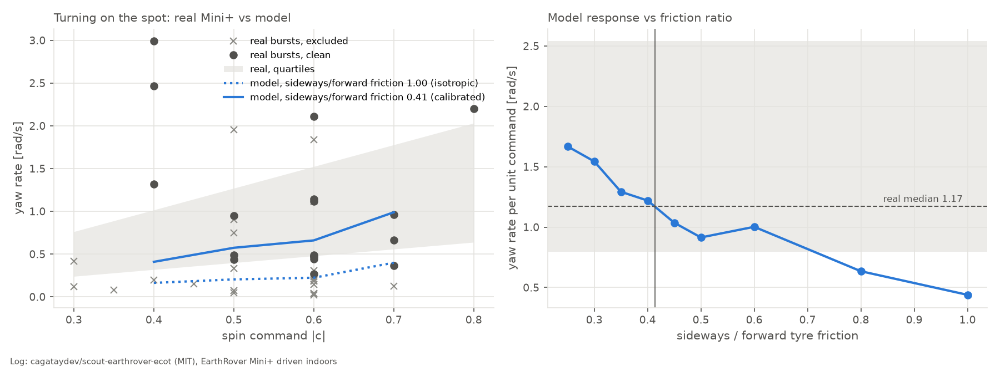
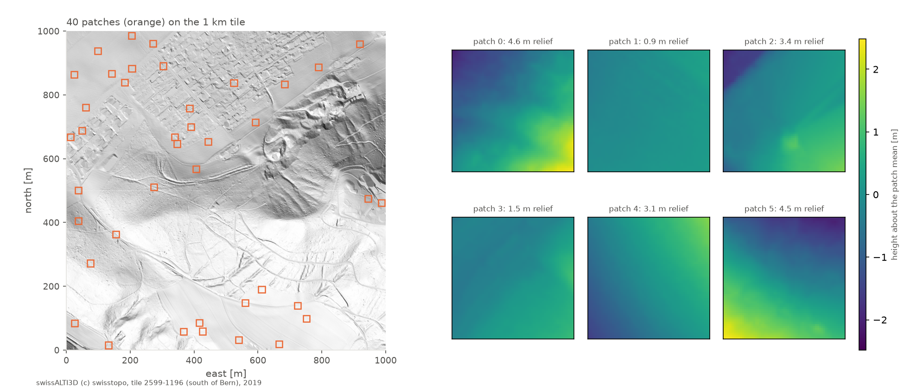
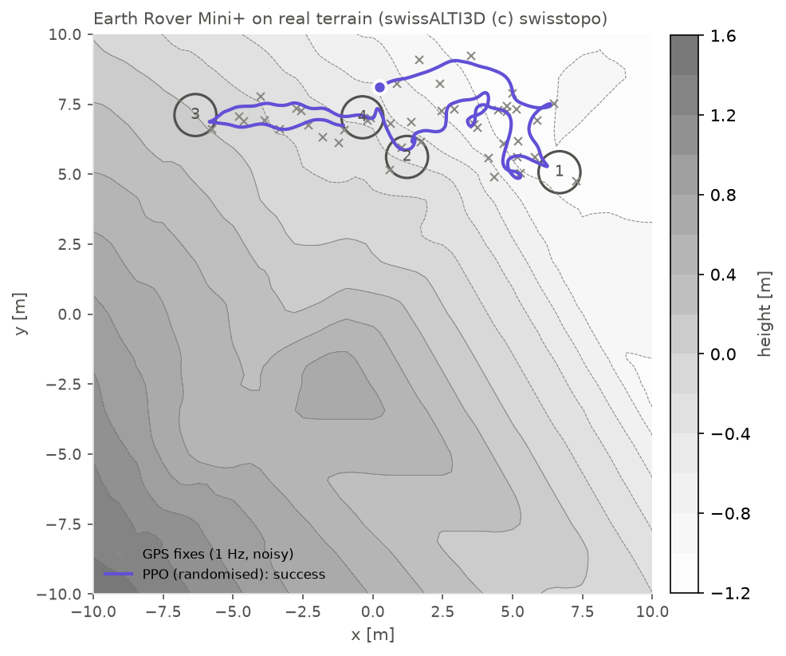
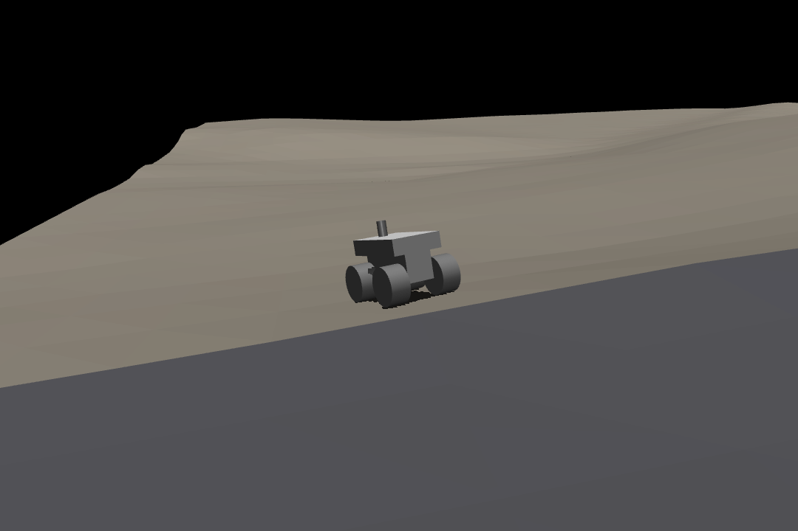
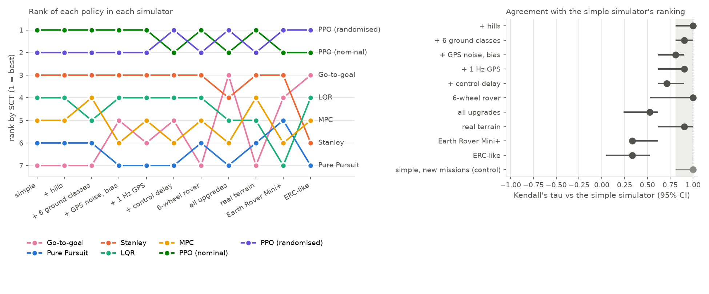
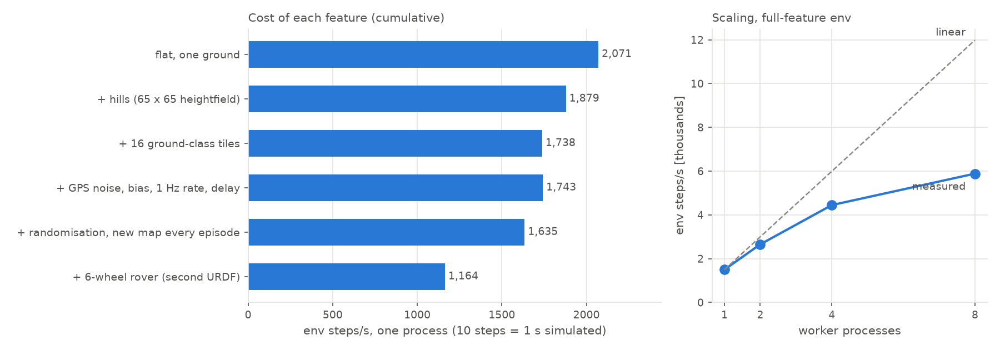

# Simulator Testbed for Wheeled Autonomous Vehicles (WhAVs)

Foundations of Robotics — course project, **Group 1**.

## Team

| Name | Roll No. | GitHub | Program |
|---|---|---|---|
| Shranay Malhotra | IIT2023093 | shrenzyy6977 | BTech |
| Harkirat Chadha | IIT2023096 | hchadha28 | BTech |
| Ujjwal Mishra | IIT2023177 | UjjWd | BTech |
| Sparsh Garg | IIT2023186 | sparshga | BTech |
| Malay Kumar Jain | MRM2025003 | jainmalaykumar | MTech |

## Project summary

We are building a software simulator / testbed for **Wheeled Autonomous Vehicles (WhAVs)**.
Topic and base work were confirmed with our TA.

- **Base paper:** J.-L. Blanco-Claraco et al., "MultiVehicle Simulator (MVSim): Lightweight dynamics simulator for multiagents and mobile robotics research", SoftwareX 23 (2023) 101443, https://doi.org/10.1016/j.softx.2023.101443
- **Base code:** https://github.com/MRPT/mvsim (docs: https://mvsimulator.readthedocs.io)
- **Scope / our contribution:** TODO (fill in once agreed with the TA)
- **Related work (2025–26):** `docs/literature-update-2025-26.md` covers Verti-Bench, URBAN-SIM,
  Wheeled Lab, Vid2Sim, NavBench-GS, MuJoCo Playground, mjlab, Isaac Lab, Chrono::CRM, ADEPT and
  FrodoBots-2K, with a comparison table against our simulator.

## Repository layout

```
external/mvsim/   upstream MVSim (git submodule, pinned to a known commit)  [if added]
worlds/           our own MVSim world files (.xml)
scripts/          our Python clients and experiment scripts
src/testbed/      our own code: 2D testbed (numpy/scipy only)
src/terrain3d/    our own code: 3D terrain simulator on MuJoCo
robots/           robot URDFs
experiments/      experiment configs and results
docs/             literature notes, simulator comparison, weekly progress logs
report/           submitted progress reports (PDF)
```

## Getting started (Ubuntu or WSL2 on Windows)

MVSim's documented install path is via ROS 2 packages (see https://mvsimulator.readthedocs.io/en/latest/install.html):

```bash
# after installing ROS 2 for your Ubuntu version
sudo apt install ros-$ROS_DISTRO-mvsim
ros2 launch mvsim demo_warehouse.launch.py
```

Building from source is described on the same page. Record the exact steps that worked
for us (OS, versions, problems) in `docs/progress/`.

## Python testbed (`src/testbed`)

A lightweight 2D Python testbed that follows MVSim's architecture (world, vehicles, sensors,
simulation loop). It lets us develop and benchmark planners and path-tracking controllers on any
laptop, without a ROS install. Work in progress.

```bash
python3 -m venv .venv && source .venv/bin/activate
pip install -r requirements.txt
python tests/run_all.py          # or: pytest -q
```

With conda instead (also installs MuJoCo / PyTorch / Stable-Baselines3 for the 3D work):

```bash
conda env create -f environment.yml && conda activate whavs
```

### Path-tracking controllers

`src/testbed/control/` has four lateral controllers behind one interface
(`compute(state, path, dt) -> (steer, accel)`), all sharing the same PI speed controller so a
comparison isolates the steering law:

| Controller | File | Law |
|---|---|---|
| Pure Pursuit | `control/geometric.py` | `delta = atan(2 L sin(alpha) / Ld)`, `Ld = k v + Ld0`, rear axle |
| Stanley | `control/geometric.py` | `delta = -theta_e - atan(k e / (ks + v))`, front axle |
| LQR | `control/optimal.py` | DARE on the kinematic lateral-error model + curvature feed-forward |
| Linear MPC | `control/optimal.py` | 20-step condensed QP with steering bounds, solved by scipy BVLS (no extra solver) |

```bash
python scripts/run_scenario.py experiments/configs/figure_eight.yaml       # one scenario, all controllers
python scripts/run_scenario.py experiments/configs/warehouse_astar.yaml    # A* path + collision checking
python scripts/benchmark.py --model dynamic_bicycle                        # full benchmark
```

Outputs go to `experiments/results/` (plots, CSV, `summary.md`).

### Benchmark results

Settings in `experiments/configs/benchmark.yaml`: 5 paths x 3 target speeds (5, 10, 15 m/s, capped on
curves by a lateral acceleration of 4 m/s^2), 1 m initial lateral offset, errors measured after 5 s.
RMS cross-track error [m] at `v_target` = 15 m/s:

| Path | Model | Pure Pursuit | Stanley | LQR | MPC |
|---|---|---|---|---|---|
| s_curve | kinematic bicycle | 0.206 | 0.146 | **0.003** | 0.024 |
| figure_eight | kinematic bicycle | 0.218 | 0.276 | **0.004** | 0.047 |
| lane_change | kinematic bicycle | 0.127 | 0.048 | **0.002** | 0.029 |
| s_curve | dynamic bicycle | 0.233 | 0.187 | **0.128** | 0.163 |
| figure_eight | dynamic bicycle | 0.311 | 0.169 | **0.167** | 0.192 |
| lane_change | dynamic bicycle | 0.154 | **0.088** | 0.098 | 0.089 |

Mean controller time per call: Pure Pursuit 0.011 ms, Stanley 0.011 ms, LQR 0.029 ms, MPC 0.18 ms
(Apple M4, single thread). Full tables: `experiments/results/benchmark_*/summary.md`.

Observations:
- On the kinematic bicycle, LQR and MPC use the same model as the plant, so they track almost
  perfectly. Once tyre slip is simulated (dynamic bicycle) the gap shrinks and Stanley becomes
  best on the lane change: **the ranking changes with the vehicle model**, which is the question
  raised in our literature review.
- Stanley's error on the circle (0.16 m on the kinematic model) is geometric: it holds the front
  axle on the path, while errors are measured at the rear axle, giving `R - sqrt(R^2 - L^2)`.
- Differential drive gives the same numbers as the kinematic bicycle because its wheel-speed limit
  is never reached at these speeds.

## 3D terrain simulator (`src/terrain3d`, MuJoCo)

First prototype of Option B from the progress review: a map-based 3D simulator in MuJoCo with
ground classes, robots loaded from URDF, and an ERC-style Gymnasium interface. It lives in its own
package because it needs MuJoCo; `src/testbed` stays plain numpy/scipy.

| Piece | File | What it does |
|---|---|---|
| Terrain | `terrain3d/terrain.py` | Elevation grid (flat, hills, slope, a `.npy` / PNG elevation map, or real 20 m patches of swisstopo's 0.5 m swissALTI3D model) cut into tiles; each tile is a heightfield with its own ground class |
| Ground classes | `terrain3d/terrain.py` | asphalt, grass, gravel, sand, snow, mud: sliding / torsional / rolling friction and contact softness (sinkage proxy). Values are placeholders to calibrate |
| Robot | `robots/rover4wd.urdf`, `robots/rover6wd.urdf`, `robots/earthrover_mini_plus.urdf`, `terrain3d/world.py` | Any URDF with joints named `wheel_*` is loaded with MjSpec, gets a free base and velocity-controlled wheel motors (skid steering) |
| Classical baselines | `terrain3d/tracking.py`, `terrain3d/baselines.py` | The four controllers from `src/testbed` drive the robot unchanged (steering output -> yaw-rate command), along a given path or, through `PathTracker`, leg by leg through a checkpoint mission from the GPS fix; `GoToGoal` steers at the next checkpoint |
| RL interface | `terrain3d/env.py` | `RoverNavEnv`: reach GNSS checkpoints with noisy GPS (0.3 m) at 1 Hz like the Earth Rover (the observation includes the age of the fix), 10 Hz control, 1-step control delay; random map and ground patches per episode |

```bash
python scripts/terrain_benchmark.py          # 4 controllers x 6 ground classes x 3 paths
python scripts/terrain_demo.py               # mixed-terrain figure + 3D render
python scripts/train_ppo.py --timesteps 500000 --envs 8
python scripts/fetch_dem.py                  # real terrain patches (downloads one 20.8 MB swisstopo tile once)
python scripts/earthrover_demo.py            # Earth Rover Mini+ mission on real terrain: map.png, render.png
```

First results (`experiments/results/terrain_benchmark/summary.md`), s-curve at 0.8 m/s over
+/-0.15 m hills, RMS cross-track error [m]:

| Ground | Pure Pursuit | Stanley | LQR | MPC | mean wheel slip |
|---|---|---|---|---|---|
| asphalt | 0.995 | **0.359** | 0.697 | 0.665 | 0.00 |
| grass | 0.076 | **0.050** | 0.101 | 0.100 | 0.04 |
| gravel | 0.096 | **0.077** | 0.153 | 0.135 | 0.02 |
| sand | 0.168 | **0.141** | 0.186 | 0.180 | 0.20 |
| snow | 0.193 | **0.154** | 0.207 | 0.222 | 0.14 |
| mud | 0.360 | **0.210** | 0.303 | 0.295 | 0.34 |

- In 2D, LQR was best on the s-curve; on 3D terrain with wheel slip, Stanley is best on every
  ground class, and on the circle Pure Pursuit is best on most grounds. The ranking depends on the
  ground and the path, which is RQ2 of the review.
- Speed: median ~130x real time per run on one CPU core (physics at 500 Hz); the Gym env runs
  ~1,600 steps/s single-threaded and ~5,900 steps/s with 8 processes on an M4 (details in RQ1 below).
- PPO baseline: 500k steps (under 3 min, 8 processes) reach all 3 checkpoints in 49/50 evaluation
  episodes on unseen random maps with 1 Hz GPS (`experiments/results/ppo/eval.csv`). The current mission is
  clearly too easy (checkpoints 3-6 m apart, gentle hills); harder ERC/URC-style missions are next.

### Earth Rover Mini+ on real terrain

`robots/earthrover_mini_plus.urdf` models the FrodoBots EarthRover Mini+, the Earth Rover
Challenge robot, as a rigid 4-wheel skid-steer:

| Quantity | Value | Source |
|---|---|---|
| Size (L x W x H) | 250 x 190 x 195 mm | [FrodoBots help centre](https://intercom.help/frodobots/en/articles/11774641-what-is-an-earthrover-types-of-bots-and-use-cases) |
| Mass | 1.4 kg (main body) | FrodoBots help centre |
| Ground clearance | 45 mm | FrodoBots help centre |
| Top speed | 4 km/h (software-capped) | FrodoBots help centre |
| Drive | 4 wheels (the SDK logs 4 wheel RPMs), two brushless motors, turns on the spot | [shop page](https://shop.frodobots.com/products/miniplus), [LeRobot docs](https://huggingface.co/docs/lerobot/en/earthrover_mini_plus) |
| Tyres | ~95 mm diameter, ~50 mm wide | measured on the side and front product photos, scaled by the published size |
| Wheelbase, track | ~155 mm, ~140 mm | same; 155 + 95 = 250 mm and 140 + 50 = 190 mm match the published size |

- **Simplifications:** the coil-spring suspension is rigid, the body is two boxes and a camera post,
  and the mass split (1.0 kg body, 4 x 0.1 kg wheels) is a guess.
- **Driving:** the model sits at the published 45 mm clearance and reaches the commanded 1 m/s on
  firm ground (0.7 m/s on sand, 0.5 m/s on mud). It climbs 20° grass slopes and stalls near 25°.
- **Turning, calibrated on a real Mini+:** see "Skid-steer turning calibration" below. Settings:
  `lateral_friction: 0.41` and, in the env, `omega_max: 3.33` (the firmware's full spin command).

#### Skid-steer turning calibration

The problem: with all its weight on four corner wheels, a skid-steer can only turn on the spot if
sideways grip / forward grip < track / wheelbase (Coulomb friction). That is 140 / 155 = 0.9 for
the Mini+. MuJoCo's contact friction is the same in every direction (ratio 1), so the model could
barely turn (0.2-0.4 rad/s for a commanded 2 rad/s); more torque did not help.

The fix (`RobotSpec.lateral_friction`, `terrain3d/world.py`): every physics step, between collision
detection and the solver, each wheel contact's friction directions are turned to follow the wheel
(rolling direction first) and the sideways coefficient is scaled by the ratio. The default 1.0
keeps MuJoCo's own contacts, so the other robots and all earlier results are unchanged. It costs
about 2.5x per physics step, for the robots that use it only.

Calibration (`scripts/calibrate_turning.py`, settings `experiments/configs/turning_calibration.yaml`):

- **Wheel speeds, from FrodoBots' open-source firmware** (`motor.c`, `pid.c`): turning on the spot
  at command c drives each side at 0.3 x 0.7 x |c| x 1.11 m/s. Pure rolling would then give
  3.33 rad/s per unit command, which becomes the Earth Rover's `omega_max`.
- **Real yaw rate, from a log:** 41 spin-in-place bursts of a real Mini+ driven indoors, measured
  from its compass heading ([cagataydev/scout-earthrover-ecot](https://huggingface.co/datasets/cagataydev/scout-earthrover-ecot),
  MIT).
  - 18 bursts are clean (turned the commanded way by at least 20°, nothing else commanded). The log's
    gyroscope columns are all zero, and 12 bursts turned the wrong way (indoor compass), so this is
    weak evidence.
  - Clean bursts: 1.17 rad/s per unit command (quartiles 0.80-2.54), a skid factor of 2.8: the
    real robot turns 2.8x slower than its wheels' rolling would suggest.
- **Model fit:** the model flies the same bursts on hard ground for a range of ratios. A
  sideways/forward ratio of **0.41** reproduces the median, and the quartiles give 0.63 to below 0.25.
  With equal grip (1.0) the model turned 2.7x slower than the real robot.

| Earth Rover Mini+, simple flat missions, 20 each | go-to-goal | Stanley |
|---|---|---|
| equal sideways and forward grip | 13/20, 36.8 s | 15/20, 34.5 s |
| calibrated (0.41, firmware command scale) | 20/20, 28.0 s | 20/20, 26.2 s |



Limits: one indoor log, compass only; the firmware mixes arcs differently (it scales both sides
together) from our env's additive mixing, so only turning on the spot is calibrated. The FrodoBots
outdoor logs with wheel RPM (FrodoBots-Mini-4K) would pin this down much better.

Real terrain: `scripts/fetch_dem.py` (settings: `experiments/configs/dem_swissalti3d.yaml`) downloads one
1 km tile of swissALTI3D (swisstopo's 0.5 m bare-earth elevation model, free open data) south of Bern.
- It cuts 40 non-overlapping 20 m patches, each with a 95th-percentile slope of at most 20° and at
  least 0.3 m of relief: 5-20° slopes and 0.9-7.6 m of relief in total.
- They are stored in `experiments/maps/swissalti3d_bern.npz` (458 kB).
- `elevation: {type: dem, path: ...}` gives the env a random patch in a random 90° orientation per map.
- Elevation data: swissALTI3D (c) swisstopo.



`python scripts/earthrover_demo.py --policy experiments/results/rq3/models/ppo_randomized_s0.zip`
flies one ERC-like mission. It uses the Earth Rover on a real patch with noisy, biased 1 Hz GPS and a
2-step control delay; this example mission (seed 4) succeeds:





### RQ2: does evaluating in the upgraded simulator change which policies rank best?

`python scripts/rq2_ranking.py` (settings: `experiments/configs/rq2_ranking.yaml`) flies seven
policies through the same 50 RQ3 checkpoint missions in a simple simulator (flat, grass, perfect GPS
every step, no delay), with each upgrade on its own, with all upgrades together, on real terrain, on
the Earth Rover Mini+, and in an ERC-like setting that combines the last two with the Earth Rover's
sensing:

- **Policies:** go-to-goal; Pure Pursuit, Stanley, LQR and MPC; PPO trained nominally and with
  randomisation (the RQ3 models, averaged over 10 seeds).
  - The four path trackers keep their terrain-benchmark gains. `PathTracker` flies them leg by leg
    from the GPS fix, turns on the spot when facing away from the leg, and replans after every
    checkpoint.
  - Each of the seven succeeds on 100% of the simple-simulator missions.
- **Score:** SCT, success weighted by completion time (Yokoyama et al., 2021): 0 for a failure,
  1 for a success at top speed on the straight route.
- **Agreement:** rankings are compared with Kendall's tau, with 95% intervals from 2,000 paired
  bootstrap resamples of missions and seeds.
- **Control:** the simple simulator again, on 50 different missions. Its tau shows how much the
  ranking moves from re-testing alone.

| Simulator | Kendall's tau vs simple | Best policy | Same best as simple |
|---|---|---|---|
| + hills (0.2-0.4 m) | 1.00 [0.81, 1.00] | PPO, nominal | 91% |
| + 6 ground classes | 0.90 [0.81, 1.00] | PPO, nominal | 80% |
| + GPS noise 0.5 m, bias 0.3 m | 0.81 [0.62, 0.90] | PPO, nominal | 72% |
| + 1 Hz GPS | 0.90 [0.62, 0.90] | PPO, nominal | 79% |
| + 2-step control delay | 0.71 [0.62, 0.90] | PPO, randomised | 48% |
| 6-wheel rover | 1.00 [0.52, 1.00] | PPO, nominal | 86% |
| **all upgrades** (hills, 6 grounds, noisy 1 Hz GPS, delay) | **0.52 [0.24, 0.62]** | **PPO, randomised** | **25%** |
| real terrain (swissALTI3D patches) | 0.90 [0.62, 1.00] | PPO, nominal | 84% |
| Earth Rover Mini+ (flat, perfect GPS, calibrated turning) | 0.33 [0.33, 0.62] | PPO, randomised | 44% |
| **ERC-like** (Earth Rover Mini+, real terrain, asphalt / grass / gravel, noisy 1 Hz GPS, delay) | **0.33 [0.05, 0.52]** | **PPO, randomised** | **25%** |
| simple, new missions (control) | 1.00 [0.81, 1.00] | PPO, nominal | 82% |

Rank by SCT (success rate):

| Policy | simple | all upgrades | ERC-like |
|---|---|---|---|
| PPO, nominal training | 1 (100%) | 2 (73%) | 2 (42%) |
| PPO, randomised training | 2 (100%) | **1 (78%)** | **1 (45%)** |
| Stanley | 3 (100%) | 4 (60%) | 6 (26%) |
| LQR | 4 (100%) | 5 (56%) | 4 (30%) |
| MPC | 5 (100%) | 6 (54%) | 5 (26%) |
| Pure Pursuit | 6 (100%) | 7 (34%) | 7 (24%) |
| Go-to-goal | 7 (100%) | **3 (72%)** | **3 (40%)** |

- **Single upgrades barely reorder the policies.**
  - Hills, ground classes and the second robot stay within the re-test band.
  - GPS noise, the 1 Hz rate and control delay move the ranking a little. Control delay moves it
    most: tau falls below the control's in 97% of resamples, and randomised PPO moves to first.
- **All upgrades together change the ranking.**
  - Tau drops to 0.52, below the control in every resample.
  - Go-to-goal moves from last to third. It beats Stanley and LQR in 97% and 98% of resamples,
    while in the simple simulator Stanley beats it in all of them.
  - Pure Pursuit falls to 34% success.
  - A likely reason: the path trackers steer on a cross-track error computed from a noisy, stale
    GPS fix, while go-to-goal only needs the bearing to the checkpoint.
- **Real terrain alone does not reorder them; the Earth Rover does.**
  - On the real swissALTI3D patches every policy still succeeds 96-98% of the time, and tau stays
    within the re-test band.
  - With calibrated turning, the Earth Rover Mini+ alone keeps success at 97-100% but reorders the
    policies: tau 0.33, below the control's in every resample.
  - The ERC-like setting is the hardest: 24-45% success. Randomised PPO is first (45%), nominal PPO
    second, and go-to-goal third (40%), ahead of every path tracker. Go-to-goal beats Stanley in 99% of
    resamples; randomised PPO beats go-to-goal in 97%.
  - About a third of its failures are tip-overs or leaving the map (the 1.4 kg rover has a 14 cm track
    and rigid suspension in the model); the rest are timeouts.
  - Before calibration the Earth Rover turned 2.7x too slowly, timeouts dominated, and go-to-goal
    looked sixth. Calibrating one physical parameter changed that conclusion, so simulator
    calibration matters for RQ2 as much as the sensing upgrades do.
- **The simple simulator barely separates the policies.**
  - All succeed, and scores span only 0.08 (0.88-0.96). With all upgrades they span 0.36.
  - A team choosing a classical controller in the simple simulator would pick Stanley; with all
    upgrades the answer is go-to-goal, on both the 4-wheel rover and the calibrated Earth Rover.
- **PPO is on top in every simulator**, including the ERC-like one on a robot it never trained on.
  Randomised training overtakes nominal training with all upgrades (89% of resamples) and in the
  ERC-like setting (87%), which is suggestive but not conclusive (RQ3 agrees).
- **Answer to RQ2:** yes, but through the combination of upgrades and the robot model, not through
  any single sensing or terrain upgrade. Evaluating only in a simple simulator would pick the wrong
  classical controller, and so would an uncalibrated robot model.
- **Caveats:**
  - PPO (nominal) was trained in the simple simulator, so it has a home advantage there.
  - The trackers' adapter (straight legs, rotate on the spot) is one reasonable design among several.
  - The PPO policies were trained on the 4-wheel rover; on the Earth Rover they are tested on an
    unseen robot.



### RQ3: does training in the upgraded simulator make policies more robust?

`python scripts/rq3_robustness.py all` (settings: `experiments/configs/rq3_robustness.yaml`) trains
PPO in two simulators and evaluates it, together with a classical go-to-goal controller
(`terrain3d/baselines.py`), on 4-checkpoint missions with a time budget of route length / 0.6 m/s:

- **nominal** training: one flat ground (grass), perfect GPS with a fresh fix every control step,
  no delay, i.e. what a simple simulator offers.
- **randomised** training: asphalt / grass / gravel / sand patches, hills up to 0.35 m, GPS noise
  0-0.5 m plus a 0.3 m bias at the Earth Rover's 1 Hz, 0-2 steps of control delay.

Every condition except nominal uses the 1 Hz GPS. Success rate (all 4 checkpoints in time), 50
identical episodes per condition, PPO 1M steps, mean ± std over 10 seeds:

| Policy | nominal | randomised | held-out ground (snow, mud) | steep hills (0.55-0.7 m) | high noise (1 m GPS, 3-step delay) |
|---|---|---|---|---|---|
| Go-to-goal | 100% | 94% | 18% | 66% | 36% |
| PPO, nominal training | 100% ± 0 | 97% ± 3 | 28% ± 7 | 70% ± 3 | 49% ± 7 |
| PPO, randomised training | 100% ± 1 | 99% ± 1 | 23% ± 6 | 73% ± 4 | 55% ± 7 |

Randomised minus nominal PPO, with the 10 per-seed success rates as samples (Welch's t-test):

| | held-out ground | steep hills | high noise |
|---|---|---|---|
| difference | -4.6 points | +2.2 points | +5.2 points |
| p | 0.136 | 0.164 | 0.112 |

- With the 1 Hz GPS, randomised training gives no significant extra robustness: it gains on high
  noise (+5.2 points) and steep hills (+2.2) and loses on unseen grounds (-4.6), none significant at
  the 5% level with seeds as the unit.
- Both PPO policies beat the classical go-to-goal controller on every hard condition, most clearly
  under heavy noise (49% and 55% vs 36%). Go-to-goal steers at each noisy fix for a whole second;
  its high-noise success fell from 62% with a fresh fix every step to 36% at 1 Hz.
- The GPS rate changed the conclusion: when every condition had a fresh fix each step, randomised
  training was significantly more robust to noise (+8.8 points, p = 0.019, 10 seeds). The sensor
  model is part of what decides which policy looks best, which is the question RQ2 asks.
- Snow and mud stay hard for everyone (18-28%): in our ground model those surfaces have low
  traction and high rolling resistance, so steep climbs often cannot be done within the time budget.

### RQ1: do the new features keep training throughput practical?

`python scripts/rq1_throughput.py` (settings: `experiments/configs/rq1_throughput.yaml`) adds the
features one at a time and measures RoverNavEnv steps/s (random actions, resets included, best of
3 runs; Apple M4, MuJoCo 3.17, physics 500 Hz, control 10 Hz):

| Env (cumulative) | steps/s, 1 process | x real time | map rebuild [ms] |
|---|---|---|---|
| flat, one ground | 2,071 | 207 | 2.4 |
| + hills (65 x 65 heightfield) | 1,879 | 188 | 2.6 |
| + 16 ground-class tiles | 1,738 | 174 | 3.3 |
| + GPS noise, bias, 1 Hz rate, control delay | 1,743 | 174 | 3.3 |
| + randomisation, new map every episode | 1,635 | 163 | 3.7 |
| + 6-wheel rover (`robots/rover6wd.urdf`) | 1,164 | 116 | 4.2 |

- All features together keep 79% of the simplest env's throughput. Perception noise and delay are
  almost free; the heightfield and the ground-class tiles cost most (contacts against 16 geoms).
- A second robot loads from its URDF with no code change (wheel joints named `wheel_left_*` /
  `wheel_right_*`); with 6 wheels instead of 4 the env is 29% slower (more contacts).
- Heightfield resolution: 65 / 129 / 257 samples per side give 1,643 / 1,409 / 1,094 steps/s.
- Processes: 1 / 2 / 4 / 8 workers give 1,498 / 2,653 / 4,448 / 5,885 steps/s (8 workers is 3.9x
  one; the M4 has 4 performance cores). PPO with 8 workers trains at 4,753 steps/s, so 1M steps
  take 3.5 min; training the 20 RQ3 policies took about 75 min.
- Answer to RQ1: yes on this laptop. Throughput stays above 100x real time per process with every
  feature on, and training a policy takes minutes, not hours.



Known limitations (to fix or calibrate next):
- Skid-steer turning: with MuJoCo's isotropic contacts the generic rovers reach only part of the
  commanded yaw rate, worst on high-friction ground (asphalt), which is why every controller does
  badly there. The Earth Rover Mini+ is calibrated (sideways/forward tyre friction 0.41, from one
  indoor log); `rover4wd` and `rover6wd` still use isotropic contacts, so all earlier results stand
  as they were.
- Ground parameters are plausible placeholders, not measured values; sinkage is approximated by soft
  contacts, there is no deformable soil.
- The Earth Rover Mini+ URDF follows the published size, mass and clearance, but tyre size, wheel
  spacing and mass split are estimated from photos, and its suspension is rigid. `rover4wd.urdf` and
  `rover6wd.urdf` stay generic.
- Real terrain comes from one 1 km tile near Bern; the ground classes on it are still assigned at
  random, not mapped from land cover.

## Workflow

- Work on a branch named `feature/<name>-<task>` and open a PR into `main`.
- Every PR gets at least one review from another member.
- Track tasks in GitHub Issues; milestones are `Week 1`, `Week 2`, ...
- Weekly logs live in `docs/progress/`.
